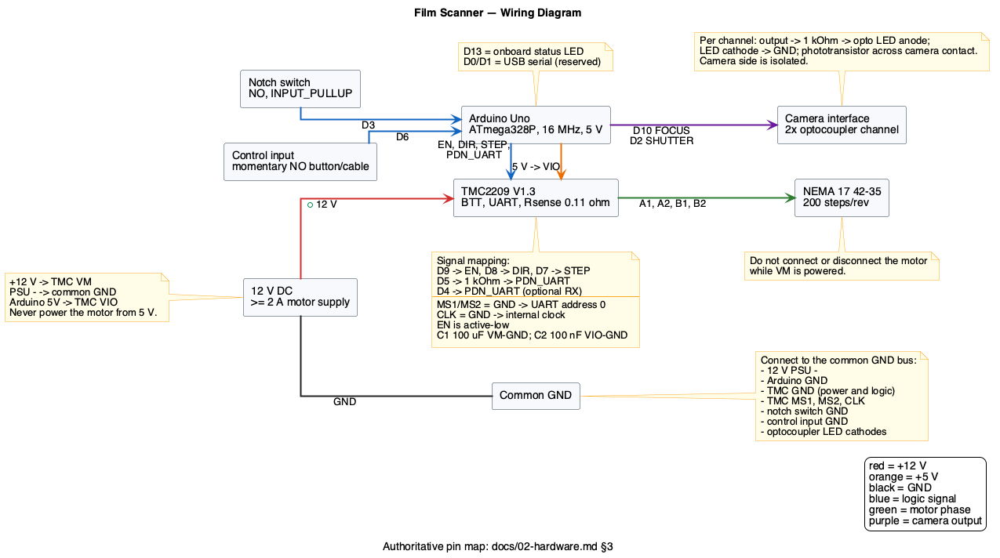

# 02 — Hardware

## 1. Overview

| Item | Part | Notes |
|---|---|---|
| Controller | Arduino Uno (ATmega328P) | 16 MHz, 5 V logic, 32 KB flash, 2 KB RAM |
| Stepper driver | BIGTREETECH TMC2209 V1.3 | UART mode, 12 V motor supply |
| Stepper motor | Artillery 42-35 NEMA 17 | 1.8°, 200 full steps/rev, 42×35 mm |
| Gearing | Fischertechnik Z20 → Z30 | Module m = 1.5 mm |
| Rack | Fischertechnik compatible | Driven by the Z30 |
| Notch sensor | Microswitch, normally open | 5 mm notches, 38 mm pitch |
| Control input | Momentary push button or cable | Used as a button only |
| Camera interface | 2 × optocoupler channels | Focus and shutter, active-high |
| Status LED | Arduino onboard LED | D13 |
| Motor supply | 12 V DC, ≥ 2 A | Separate from Arduino 5 V |

The holder does **not** back-drive when the motor is disabled, so the driver is
disabled in `IDLE` and `FAULT`. No holding current is required at rest. The
`ENABLE` serial command is a maintenance override that keeps the driver
energized in `IDLE` for setup and is cleared by `DISABLE`, any motion command,
`ABORT`, or a fault.

## 2. Block diagram

```
                    +5 V (USB)
                       │
                 ┌─────┴─────┐
                 │ Arduino   │
                 │ Uno       │
                 └─────┬─────┘
      D5 (TX) ─────────┤ 1 kΩ ────── PDN_UART ─┐
      D4 (RX, optional)┤───────────────────────┤
      D7 (STEP) ───────┤                       │
      D8 (DIR) ────────┤     ┌──────────────┐  │
      D9 (EN) ─────────┼────►│ TMC2209 V1.3 │◄─┘
      D2 (SHUTTER) ────┤     │  VM = 12 V   │
      D10 (FOCUS) ─────┤     │  VIO = 5 V   │
      D3 (NOTCH) ──────┼──┐  └──────┬───────┘
      D6 (CONTROL) ────┼─┐│         │ A1 A2 B1 B2
      D13 (LED) ───────┤ ││         ▼
                       │ ││   NEMA 17 (42-35)
                       │ ││         │
                       │ ││   Z20 ─► Z30 ─► rack ─► holder
                       │ ││                         │
                       │ │└── notch switch ◄────────┘
                       │ └─── control button/cable ─► GND
                       └───── camera optocouplers (focus, shutter)
```

### 2.1 Wiring diagram



The complete wiring diagram — Arduino, TMC2209, motor, switches, camera
interface and power distribution — is [wiring.puml](wiring.puml), rendered to
[wiring.svg](wiring.svg) and [wiring.png](wiring.png). Re-render after editing:

```bash
plantuml -tsvg docs/wiring.puml   # writes docs/wiring.svg
plantuml -tpng docs/wiring.puml   # writes docs/wiring.png
```

The diagram shows the power rails and every signal connection at component
level. The authoritative pin-to-pin list is §3 and §4; the pin mapping is also
repeated in the note attached to the Arduino block.

## 3. Pin map

| Pin | Name | Direction | Active | Function |
|---|---|---|---|---|
| D0 | RX | — | — | USB serial (reserved) |
| D1 | TX | — | — | USB serial (reserved) |
| D2 | `PIN_CAMERA_SHUTTER` | Output | HIGH | Camera shutter optocoupler |
| D3 | `PIN_NOTCH` | Input | LOW | Notch microswitch (`INPUT_PULLUP`) |
| D4 | `PIN_TMC_RX` | Input | — | Optional TMC UART readback |
| D5 | `PIN_TMC_TX` | Output | — | TMC UART transmit (via 1 kΩ) |
| D6 | `PIN_CONTROL` | Input | LOW | Momentary button/cable (`INPUT_PULLUP`) |
| D7 | `PIN_STEP` | Output | — | TMC STEP |
| D8 | `PIN_DIR` | Output | — | TMC DIR |
| D9 | `PIN_EN` | Output | LOW | TMC enable (active-low) |
| D10 | `PIN_CAMERA_FOCUS` | Output | HIGH | Camera focus optocoupler |
| D11 | — | — | — | Free |
| D12 | — | — | — | Free |
| D13 | `PIN_STATUS_LED` | Output | HIGH | Onboard status LED |

`D0`/`D1` are owned by the USB serial port. Never use them for anything else.
The pin map is compile-time only; it is not a persisted configuration key.
`CONFIG` prints it for reference.

### 3.1 Pin configuration (Arduino)

```cpp
pinMode(PIN_NOTCH, INPUT_PULLUP);
pinMode(PIN_CONTROL, INPUT_PULLUP);
pinMode(PIN_CAMERA_FOCUS, OUTPUT);
pinMode(PIN_CAMERA_SHUTTER, OUTPUT);
pinMode(PIN_STATUS_LED, OUTPUT);
pinMode(PIN_STEP, OUTPUT);
pinMode(PIN_DIR, OUTPUT);
pinMode(PIN_EN, OUTPUT);
digitalWrite(PIN_EN, HIGH);          // disabled (active-low)
digitalWrite(PIN_CAMERA_FOCUS, LOW);
digitalWrite(PIN_CAMERA_SHUTTER, LOW);
```

## 4. Wiring

### 4.1 TMC2209

BIGTREETECH TMC2209 V1.3 pinout (module pins):

| Module pin | Connect to |
|---|---|
| `VM` | +12 V motor supply |
| `GND` (power) | 12 V supply ground and Arduino GND |
| `VIO` | Arduino 5 V |
| `GND` (logic) | Arduino GND |
| `EN` | D9 (active-low) |
| `STEP` | D7 |
| `DIR` | D8 |
| `PDN_UART` | UART (see below) |
| `MS1` | GND (address 0) |
| `MS2` | GND (address 0) |
| `CLK` | GND (use internal clock) |
| `DIAG` | Not connected |
| `A1`, `A2` | Motor coil A |
| `B1`, `B2` | Motor coil B |

Notes:

- The board uses **110 mΩ** sense resistors (`R_SENSE = 0.11`). Do not assume
  0.075 Ω or 0.12 Ω.
- The factory Vref is about 1.2 V (~0.9 A RMS). In UART mode the current is set
  by registers; the potentiometer is not the control path. Configure
  `I_scale_analog(false)` and use `rms_current()`.
- `EN` is active-low: LOW enables the driver, HIGH disables it.
- Do not connect or disconnect the motor while `VM` is powered.
- Add a 100 µF electrolytic capacitor across `VM`/GND near the driver and a
  100 nF ceramic across `VIO`/GND. This is standard TMC practice and prevents
  supply spikes.

### 4.2 UART: one wire (default) or two wires

**One-wire (TX only) — required to work:**

```
Arduino D5 (TX) ──[1 kΩ]── PDN_UART
Arduino D4 (RX) ── not connected
```

The 1 kΩ series resistor protects the driver's UART pin. The TMC2209 performs
automatic baud-rate detection, so the firmware may use 115200 baud. SoftwareSerial
on a 16 MHz Uno is reliable for transmission at this rate; readback is optional.

**Two-wire (readback) — optional:**

```
Arduino D5 (TX) ──[1 kΩ]── PDN_UART
Arduino D4 (RX) ─────────── PDN_UART
```

Readback enables `test_connection()`, `driver_error()`, and `global_status()`.
If readback is unreliable, lower the UART baud (for example 57600 or 19200) or
fall back to one-wire. The firmware MUST start and run with one-wire.

`MS1`/`MS2` select the UART address (0–3). Both to GND = address 0. Microsteps
are set over UART; the MS pins are only address straps in UART mode.

### 4.3 Motor

| Driver | Motor |
|---|---|
| `A1` | Coil A+ |
| `A2` | Coil A− |
| `B1` | Coil B+ |
| `B2` | Coil B− |

If the motor turns the wrong way, swap one coil pair (A1/A2) or invert the DIR
adapter in firmware. Do not swap wires while powered.

### 4.4 Notch microswitch

```
D3 ──────┬───── switch (NO)
         │
        (internal pull-up)
         │
GND ─────┴───── switch common
```

- Normally open, closes on a notch.
- Pin reads **LOW** when the switch is closed.
- `INPUT_PULLUP`; no external resistor required.
- Debounce 10 ms in firmware.
- The switch must be mounted so the lever drops into the 5 mm notch and is
  released in the 33 mm gap.

### 4.5 Control input (button or cable)

```
D6 ──────┬───── button / cable
         │
        (internal pull-up)
         │
GND ─────┴───── button / cable
```

- Momentary, normally open, closes to GND.
- Pin reads **LOW** while pressed/connected.
- `INPUT_PULLUP`; no external resistor.
- The firmware treats this as a **button only**. A cable is used by connecting
  and disconnecting it like a button press.
- A cable left permanently connected is a held button: at boot it is ignored
  until released; after boot a 2 s hold triggers the long-press action. It is
  **not** a run-enable input.
- Debounce 20 ms; short press = release before 2 s; long press = 2 s hold.

### 4.6 Camera

The camera is triggered by two independent dry-contact closures, one for focus
(half-press) and one for shutter (full-press). Use two optocoupler channels so
the camera is galvanically isolated from the Arduino.

Example channel (repeat for focus and shutter):

```
Arduino D10 (or D2) ──[1 kΩ]── opto LED anode
opt o LED cathode ──────────── GND
opt o phototransistor ──────── camera focus (or shutter) contact
```

- Arduino output HIGH = opto LED on = camera contact closed.
- Arduino output LOW = contact open.
- The camera side is isolated; do not connect camera ground to Arduino ground
  unless the camera interface requires it.
- Default pulse: focus high for 300 ms, then shutter high for 150 ms while focus
  remains high, then both low, then 300 ms post-shot delay.
- `SHOOT` runs the same sequence without moving the holder.
- Some cameras need a longer focus delay; tune `focusMs` and `shutterMs`.

If the camera uses a TRS/TRRS remote jack, identify the focus and shutter
contacts with a multimeter in continuity mode before wiring. The firmware only
knows "two active-high outputs"; the electrical details live here.

### 4.7 Status LED

- Onboard LED on D13, active-high.
- No external resistor needed for the onboard LED.
- Patterns:
  - `IDLE`: 1 Hz blink (500 ms on, 500 ms off).
  - Active (`SEEK`, `STOPPING`, `OFFSET`, `CAMERA`, `JOG`): solid on.
  - `FAULT`: 5 Hz blink (100 ms on, 100 ms off).
  - `BOOT`: solid for the first 500 ms, then the state pattern.

### 4.8 Power

```
12 V PSU + ─────────────── TMC VM
12 V PSU − ───┬─────────── Common GND bus
              │                 ├── TMC GND (power)
              │                 ├── TMC GND (logic)
              │                 ├── Arduino GND
              │                 ├── notch switch GND
              │                 ├── control input GND
              │                 └── optocoupler LED cathodes
USB 5 V ───────────────── Arduino 5V
Arduino 5V ────────────── TMC VIO
```

- Power the Arduino from USB. If you must use `VIN`, keep it ≤ 9 V to avoid
  overheating the linear regulator; 12 V into `VIN` is not recommended.
- The 12 V supply and the Arduino must share ground. A single common ground
  point near the driver is best.
- Never power the motor from the Arduino 5 V rail.
- Add the decoupling capacitors described in §4.1: 100 µF across `VM`/GND and
  100 nF across `VIO`/GND, close to the driver.
- The camera side is isolated through the optocouplers; do not tie camera
  ground to the 12 V ground unless the camera interface requires it.
- The optional TMC UART readback wire (`D4` → `PDN_UART`) is not a power
  connection; see §4.2.

## 5. Mechanics

### 5.1 Gearing

Fischertechnik gears use module **m = 1.5 mm**:

| Part | Teeth | Pitch diameter | Circumference |
|---|---|---|---|
| Motor gear | Z20 | 30 mm | 94.248 mm |
| Intermediate | Z30 | 45 mm | 141.372 mm |
| Rack | — | — | pitch 4.712 mm/tooth |

The Z20 on the motor drives the Z30; the Z30 drives the rack.

### 5.2 Derived motion constants

| Quantity | Formula | Value |
|---|---|---|
| Rack travel per Z30 rev | π × 45 mm | 141.3717 mm |
| Motor revs per Z30 rev | 30 / 20 | 1.5 |
| Rack travel per motor rev | 141.3717 / 1.5 | 94.2478 mm |
| Full steps per mm | 200 / 94.2478 | 2.1221 |
| Microsteps per mm @ 1/16 | 2.1221 × 16 | 33.953 |
| Microsteps per frame (38 mm) | 38 × 33.953 | 1,290.2 |
| Microsteps per notch (5 mm) | 5 × 33.953 | 169.8 |
| Resolution @ 1/16 | 1 / 33.953 | 0.02945 mm |

These values are **diagnostics and calibration aids**. Positioning always stops
on the sensor; `expectedFrameSteps` is not used to drive the motor.

### 5.3 Notches and holder gap

```
|<--------------- 38 mm ---------------->|
[ notch 5 mm ]      gap 33 mm            [ notch 5 mm ]
```

- Notch width: 5 mm.
- Notch pitch (start to start): 38 mm.
- Gap between the last notch of one holder and the first notch of the next:
  47 mm, possibly 57 mm if the next holder is not gripped immediately.
- At 400 µsteps/s, 47 mm takes 1.24 s and 57 mm takes 1.50 s. The 15 s timeout
  covers ~177 mm, so it will not false-trigger on the gap.

### 5.4 Direction

- "Forward" = toward the next frame / magazine.
- Scanning is forward only.
- `JOG` may be negative for setup and unjamming.
- If forward is reversed, swap one motor coil pair or invert the DIR adapter.

## 6. Assembly checklist

1. Mount the motor, Z20, Z30, and rack with minimal backlash but free movement.
2. Verify the rack moves the holder smoothly by hand before powering the motor.
3. Mount the notch switch so the lever fully drops into the 5 mm notch and is
   fully released in the 33 mm gap.
4. Mount the control button/cable so it is normally open.
5. Wire the TMC2209 with the 1 kΩ UART resistor; double-check `VM`, `VIO`, and
   grounds before powering.
6. Wire the camera optocouplers; verify polarity with a multimeter.
7. Connect the 12 V supply with the driver disabled (`EN` high).
8. Power the Arduino over USB and confirm the LED pattern.
9. Run `PING`, `VERSION`, `STATUS`, `CONFIG` over serial.
10. Run the calibration procedure in `08-calibration.md`.

## 7. Safety

- Keep hands clear of the rack, holder, and camera while a run is active.
- Use `ABORT` or a 2 s long press for an immediate stop.
- Do not disconnect the motor while `VM` is powered.
- Do not exceed 2 A RMS on the TMC2209; the default 900 mA RMS is conservative.
- Check motor and driver temperature after the first 10 minutes. If either
  exceeds ~70 °C, reduce `runCurrentMa`.
- The firmware watchdog resets the board after 2 s of a hung loop and disables
  the motor.
- The camera flash (if any) is not controlled by the firmware; follow the
  camera's safety instructions.

## 8. Hardware FAQ

**Can I use a jumper instead of a button?**
Yes, but only as a momentary contact: connect it, then disconnect it. It is not
a level/run-enable input. If left connected at boot, it is ignored until
released; after boot, holding it for 2 s triggers the long-press action.

**Can I use a different driver?**
The firmware is written for the TMC2209. A pin-compatible TMC2208 would mostly
work but has no StallGuard4 and a different UART register set. Do not swap
without updating the driver adapter and docs.

**Can I use a different motor?**
Any 4-wire bipolar stepper with 200 full steps/rev will work after checking
current and direction. If the steps/rev differs, update the derived constants
and recalibrate the offset.

**Why 1/16 microstepping?**
It gives 0.029 mm resolution, smooth low-speed motion, and 1,290 µsteps per
frame — well within the Uno's step-rate capability. The TMC2209 interpolates to
1/256 internally, so the motion is smooth despite the 1/16 input.
