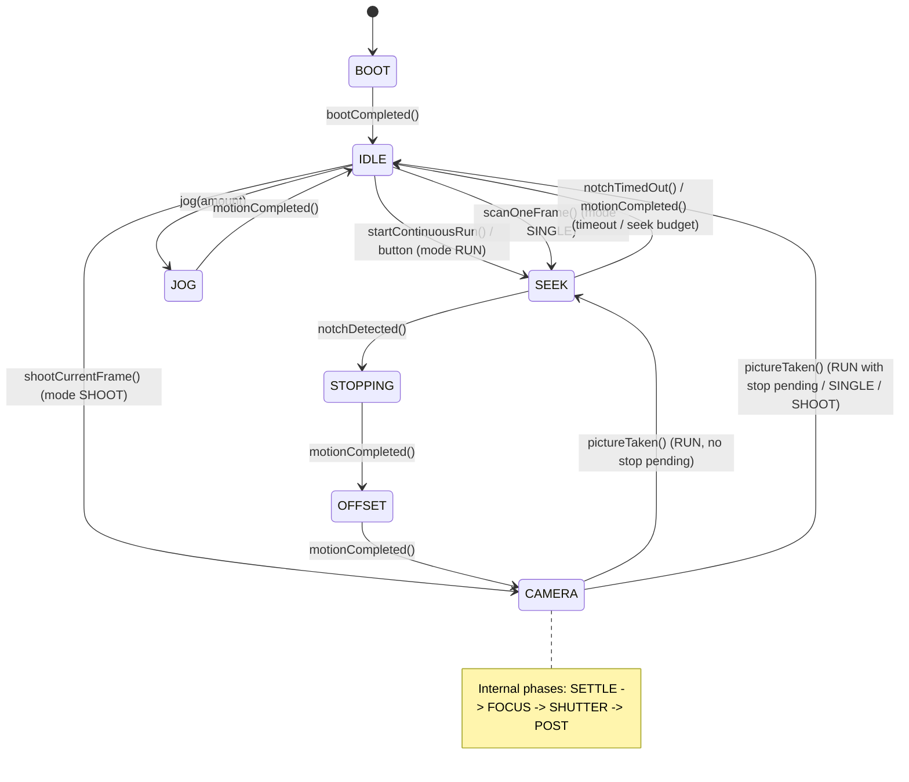
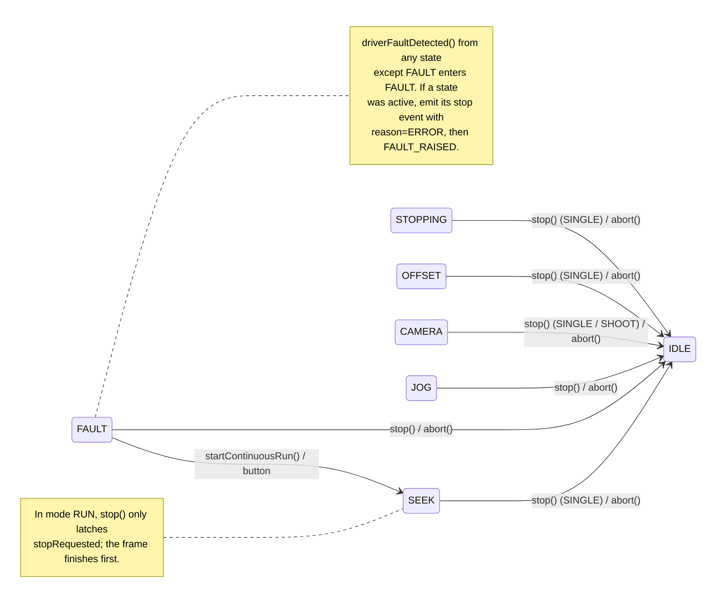

# 03 — Architecture

## 1. Goals

- Keep all decision logic independent of Arduino so it can be unit-tested on a
  PC.
- Keep the main loop non-blocking so step pulses and sensor polling stay
  responsive.
- Make every hardware interaction replaceable by a fake.
- Keep the code small enough for an Uno.

## 2. Layering

```
┌──────────────────────────────────────────────────────────────┐
│ src/  (Arduino only)                                         │
│  main.cpp            composition root                        │
│  hal/                ArduinoClock, ArduinoInput,             │
│                      ArduinoOutput, AccelStepperMotor,       │
│                      TmcStepperDriver, EepromStore,          │
│                      SerialLogSink, SerialEventSink,         │
│                      SerialStatusSink, SerialCommandHandler  │
└───────────────────────────┬──────────────────────────────────┘
                            │ implements / uses
┌───────────────────────────▼──────────────────────────────────┐
│ lib/scanner_core/  (pure C++11, no Arduino.h)                │
│  StateMachine  (pure activity FSM; no project dependencies)  │
│  ScannerController  (orchestrator: entry/exit, timing,       │
│                      counters, protocol events)              │
│  IMotionController, StepperMotionController                  │
│  NotchSensor, Button, Camera, StatusLed                      │
│  Config, ConfigRecord, ConfigManager, Logger, CommandParser  │
│  interfaces: IClock, IInput, IOutput, IStepperMotor,         │
│              IMotionController, ITmcDriver,                  │
│              INonVolatileStore, ILogSink, IEventSink,        │
│              IStatusSink                                     │
└──────────────────────────────────────────────────────────────┘
```

Dependency rule: arrows point **inward**. `scanner_core` never includes
`Arduino.h`, `TMCStepper.h`, `AccelStepper.h`, or `EEPROM.h`.

Within the core:

- `StateMachine` depends on nothing but the language and its own vocabulary
  header; it has no clock, config, hardware or protocol types.
- Components never include `ConfigManager.h`. Each consumer defines and stores
  its own slice; `ConfigManager` owns the aggregate and pushes changes into the
  consumers. See [ADR-0007](adr/0007-config-ownership-and-push.md).
- `ScannerController` orchestrates through entry/exit actions and interface
  calls; it does not encode hardware details. See
  [ADR-0008](adr/0008-pure-state-machine-and-orchestrator.md) and
  [ADR-0009](adr/0009-motion-controller-interface.md).

## 3. Module responsibilities

| Module | Responsibility |
|---|---|
| `StateMachine` | Pure activity state machine: states, modes, one method per event, `Result` with error, stop reason and announcements. Defines `State`, `Mode`, `StopReason`, `Announcement`, `ErrorCode`. No hardware, clock, config or protocol types |
| `Types` | Protocol vocabulary: `CameraPhase`, `ButtonEvent`, `EventType`, `Event`, `StatusSnapshot`, and `toString` helpers |
| `Config` | The aggregate `Config` of consumer-owned slices, defaults, ranges and validation |
| `ConfigRecord` | The persisted wire format: its own flat fields, header and checksum, plus the mapping to and from `Config` |
| `ConfigManager` | Own the aggregate `Config`; load/save/reset, `get`/`set` by key, validation, persistence, and explicit `applyConfig` pushes into the consumers. Depends on the consumers; they never depend on it |
| `NotchSensor` | Debounce the notch input, expose stable state and one-shot edges; owns `NotchConfig` |
| `Button` | Debounce the control input, classify short/long press, handle boot-held contact; owns `ButtonConfig` |
| `Camera` | Focus/shutter pulse sequencer with settle and post-shot delays; abort completes an active pulse; owns `CameraConfig` |
| `IMotionController` | Activity-level motion interface: seek, offset, jog, stop, halt, idle, maintenance enable/disable, poll |
| `StepperMotionController` | `IMotionController` implementation over `IStepperMotor`; owns speeds, acceleration, offset, seek budget, enable/override policy |
| `ScannerController` | Orchestrator: translates inputs into state-machine calls, runs entry/exit actions, owns timeouts, jog payload, frame counters, protocol events and status |
| `StatusLed` | LED patterns from `State` |
| `Logger` | Level filtering and fixed-buffer formatting; owns `LogConfig` |
| `CommandParser` | Parse one ASCII line into a `Command`; pure function |
| `CommandHandler` (HAL) | Dispatch parsed commands to `ScannerController` / `ConfigManager`, print responses. Does not re-apply config: the push already did |
| HAL adapters | Thin wrappers around Arduino, AccelStepper, TMCStepper, EEPROM, Serial |

## 4. Interfaces

The declarations live in `lib/scanner_core/include/scanner_core/`. This section
pins what each seam is for and the rules that a signature cannot express.

| Interface | Implemented by | Responsibility |
|---|---|---|
| `IClock` | `ArduinoClock` | Monotonic milliseconds |
| `IInput` | `ArduinoInput` | Active-low digital input |
| `IOutput` | `ArduinoOutput` | Digital output |
| `IStepperMotor` | `AccelStepperMotor` | STEP/DIR pulses, enable, position |
| `IMotionController` | `StepperMotionController` | Motion in activities; owns units, speeds and the enable policy |
| `ITmcDriver` | `TmcStepperDriver` | TMC2209 registers and diagnostics; never generates steps |
| `INonVolatileStore` | `EepromStore` | Read and write the record bytes at address 0 |
| `ILogSink` | `SerialLogSink` | One log line |
| `IEventSink` | `SerialEventSink` | One protocol event |
| `IStatusSink` | `SerialStatusSink` | One `STATUS` line |

Rules that belong to the seams rather than to a caller:

- `IInput::read()` returns true for the *active* level, so no caller sees
  polarity. The HAL applies `INPUT_PULLUP` and inverts.
- `ITmcDriver::hasFault()` returns false when UART readback is unavailable. The
  firmware then relies on the notch timeout instead of the fault line.
- `INonVolatileStore` is a byte block at address 0. It knows nothing about
  `Config` or `ConfigRecord`; the record's header and checksum are validated
  above it, in the core.
- `IMotionController::halt()` is used only for `ABORT`, timeouts and faults. At
  the default 400 µsteps/s it is mechanically safe; `stop()` is the normal
  deceleration path.
- `IMotionController` owns enable, microsteps and offset units. Nothing above it
  mentions a pin, a pulse or a step rate.
- `IStatusSink` is used for `STATUS` only, both explicit and periodic.

`Types.h` includes `StateMachine.h` for the shared vocabulary; the state machine
never includes `Types.h`. `StatusSnapshot` carries exactly the fields of the
`STATUS` line, so the two cannot drift apart.

## 5. Vocabulary and config slices

The wire vocabulary is defined once, in the protocol document:
[05-serial-protocol.md §4.4](05-serial-protocol.md#44-status) for the `STATUS`
field values, [§5](05-serial-protocol.md#5-events) for the event names and
`reason` values, and [§7](05-serial-protocol.md#7-error-codes) for the error
codes. The C++ declarations live in `StateMachine.h` and `Types.h`; they are not
repeated here.

`StateMachine.h` owns `State`, `Mode`, `StopReason`, `ErrorCode`, `Announcement`
and `Result`. `Types.h` owns `CameraPhase`, `ButtonEvent`, `EventType`, `Event`,
`StatusSnapshot` and the `toString` helpers that produce the wire names.

`Announcement` is internal: it never reaches the host, so its members are not
part of the specification. The protocol events are named in
[05-serial-protocol.md §5](05-serial-protocol.md#5-events); `Announcement` is the
bitmask that carries the same facts from the machine to the orchestrator.

Configuration is split into one slice per consumer, defined next to it:

| Slice | Consumer | Keys |
|---|---|---|
| `NotchConfig` | `NotchSensor` | `notchDebounceMs` |
| `ButtonConfig` | `Button` | `buttonDebounceMs`, `longPressMs` |
| `CameraConfig` | `Camera` | `settleMs`, `focusMs`, `shutterMs`, `postShotMs` |
| `MotionConfig` | `IMotionController` | `seekSpeed`, `acceleration`, `jogSpeed`, `offsetSteps`, `maxSeekSteps` |
| `RunConfig` | `ScannerController` | `notchTimeoutMs`, `statusPeriodMs` |
| `DriverConfig` | `ITmcDriver` | `microsteps`, `runCurrentMa`, `holdCurrentPercent`, `stealthChop` |
| `LogConfig` | `Logger` | `logLevel` |

`Config` is the aggregate that `ConfigManager` owns. The persisted record is a
separate representation in `ConfigRecord.h`, mapped to and from the aggregate by
`ConfigManager`; the docs specify its behaviour, not its layout
([ADR-0010](adr/0010-persistence-record-is-a-separate-representation.md)).
`ConfigManager::set()` returns `ErrorCode`: there is no change descriptor,
because the push into the consumer *is* the application.

## 6. State machine

`StateMachine` is pure. It has no clock, config, hardware or protocol types; see
[ADR-0008](adr/0008-pure-state-machine-and-orchestrator.md). States represent
activities that last over time. Entry and exit actions belong to
`ScannerController` (§7.6).

States: `BOOT`, `IDLE`, `SEEK`, `STOPPING`, `OFFSET`, `CAMERA`, `JOG`, `FAULT`.
Camera sub-phases (inside `CAMERA`): `SETTLE`, `FOCUS`, `SHUTTER`, `POST`.
Modes: `NONE`, `RUN`, `SINGLE` (`STEP`), `SHOOT` (`SHOOT`). `JOG` is a state, not
a mode.

**Normal activity flow.**



**Stop, abort, fault and recovery.**



The diagrams are an overview; the table in §6.1 is the complete, authoritative
transition list. `CAMERA` internally steps through `SETTLE`, `FOCUS`, `SHUTTER`,
`POST` (§6.2).

### 6.1 Events and transitions

Each event is a method. `Result.announcements` lists the protocol facts the
orchestrator must emit.

| Current | Method | Guard | Next | Announcements |
|---|---|---|---|---|
| `BOOT` | `bootCompleted()` | — | `IDLE` | — |
| `IDLE` | `startContinuousRun()` | — | `SEEK` | `RUN_STARTED` |
| `FAULT` | `startContinuousRun()` | — | `SEEK` | `RUN_STARTED` |
| `IDLE` | `scanOneFrame()` | — | `SEEK` | — |
| `IDLE` | `shootCurrentFrame()` | — | `CAMERA` | — |
| `IDLE` | `jog()` | amount checked by the controller | `JOG` | — |
| `IDLE`, `FAULT` | `buttonPressedShort()` / `buttonPressedLong()` | — | `SEEK` | `RUN_STARTED` |
| `IDLE` | `stop()` | — | `IDLE` | — |
| `IDLE` | `abort()` | — | `IDLE` | — |
| `SEEK` | `notchDetected()` | — | `STOPPING` | `NOTCH` |
| `SEEK` | `notchTimedOut()` | mode `RUN` | `IDLE` | `RUN_STOPPED` reason `NOTCH_TIMEOUT` |
| `SEEK` | `notchTimedOut()` | mode `SINGLE` | `IDLE` | `STEP_FAILED` code `NOTCH_TIMEOUT` |
| `SEEK` | `motionCompleted()` | mode `RUN` | `IDLE` | `RUN_STOPPED` reason `MOTION_TIMEOUT` |
| `SEEK` | `motionCompleted()` | mode `SINGLE` | `IDLE` | `STEP_FAILED` code `MOTION_TIMEOUT` |
| `STOPPING` | `motionCompleted()` | — | `OFFSET` | — |
| `OFFSET` | `motionCompleted()` | — | `CAMERA` | `FRAME_STARTED` |
| `CAMERA` | `pictureTaken()` | `RUN`, no stop pending | `SEEK` | `FRAME_DONE` |
| `CAMERA` | `pictureTaken()` | `RUN`, stop pending | `IDLE` | `FRAME_DONE`, `RUN_STOPPED` reason `REQUEST` |
| `CAMERA` | `pictureTaken()` | `SINGLE` | `IDLE` | `FRAME_DONE`, `STEP_DONE` |
| `CAMERA` | `pictureTaken()` | `SHOOT` | `IDLE` | `SHOT_DONE` |
| `CAMERA` | `stop()` | `SHOOT` | `IDLE` | `SHOT_STOPPED` reason `REQUEST` |
| `JOG` | `motionCompleted()` | — | `IDLE` | `JOG_DONE` |
| `JOG` | `stop()` | — | `IDLE` | `JOG_STOPPED` reason `REQUEST` |
| `SEEK`/`STOPPING`/`OFFSET`/`CAMERA` | `stop()` | mode `SINGLE` | `IDLE` | `STEP_STOPPED` reason `REQUEST` |
| `SEEK`/`STOPPING`/`OFFSET`/`CAMERA` | `stop()` | mode `RUN` | unchanged | none; `stopRequested` is latched |
| any active | `abort()` | — | `IDLE` | mode stop announcement, reason `ABORT` |
| any state except `FAULT` | `driverFaultDetected()` | — | `FAULT` | mode stop announcement if active, reason `ERROR`; `FAULT_RAISED` |
| `FAULT` | `stop()` / `abort()` | — | `IDLE` | — |

Mode is set by the command that starts an activity: `RUN` for
`startContinuousRun()`, `SINGLE` for `scanOneFrame()`, `SHOOT` for
`shootCurrentFrame()`. `JOG` leaves the mode at `NONE`.

`lastError` lives in the state machine. An accepted `startContinuousRun()`,
`scanOneFrame()`, `shootCurrentFrame()` or button press from `FAULT` clears it;
so do `stop()` and `abort()` from `FAULT`. The controller reads it for `STATUS`.

`stopRequested` is a flag, not a state. When set during `RUN`, the machine keeps
the mode and frame; after `pictureTaken()` it goes to `IDLE` and announces
`RUN_STOPPED reason=REQUEST`.

Frame counters (`frames`, `runFrames`) belong to `ScannerController`, because
they are reporting data. The machine's announcements tell it when to count:
`RUN_STARTED` resets `runFrames`; `FRAME_DONE` increments both.

A method that is not listed for the current state returns `error=BUSY` and leaves
the state, mode and announcements unchanged.

### 6.2 Frame sequence

```
SEEK:      motion.startSeek()
NOTCH:     motion.stop()                 // on exit from SEEK
STOPPING:  wait for motionCompleted()
OFFSET:    motion.applyOffset()         // on entry; signed, skipped if 0
           wait for motionCompleted()
CAMERA:    camera.start()
           SETTLE  (settleMs)  → focus HIGH
           FOCUS   (focusMs)   → shutter HIGH
           SHUTTER (shutterMs) → shutter LOW, focus LOW
           POST    (postShotMs)
DONE:      RUN → SEEK; SINGLE/SHOOT → IDLE
```

The offset is applied **after** the controlled stop. The stop distance depends on
seek speed and acceleration, so changing either requires recalibrating
`offsetSteps`.

If the offset is zero, entering `OFFSET` produces no motion; the controller
reports `motionCompleted()` immediately so the machine advances to `CAMERA`.

### 6.3 Entry and exit actions

`ScannerController` compares the previous and next state and runs one action.
Entry actions depend only on the target state:

| Enter | Action |
|---|---|
| `SEEK` | `motion.startSeek()` |
| `STOPPING` | none; the stop was issued on exit from `SEEK` |
| `OFFSET` | `motion.applyOffset()` |
| `CAMERA` | `camera.start()` |
| `JOG` | `motion.startJog(pendingAmount)` |
| `IDLE` | `motion.idle()` |
| `FAULT` | `motion.idle()` |

Exit actions depend on the target state and on `reason`:

| Exit | Condition | Action |
|---|---|---|
| `SEEK` | next is `STOPPING` | `motion.stop()` |
| `SEEK`/`STOPPING`/`OFFSET`/`JOG` | `reason != NONE` | `motion.halt()` |
| `CAMERA` | `reason != NONE` | `camera.abort()` |

A graceful run stop after a completed frame exits `CAMERA` with reason
`REQUEST`; `Camera::abort()` on a finished sequence is a no-op, so the rule stays
simple.

`motionCompleted()` carries the meaning of the current state: stop finished in
`STOPPING`, offset finished in `OFFSET`, jog finished in `JOG`, seek budget
exhausted in `SEEK`.

### 6.4 Graceful stop vs. abort

- `STOP` / short press while `mode=RUN`: set `stopRequested`; continue the
  current frame to completion; then `IDLE` + `RUN_STOPPED reason=request`.
- `STOP` / short press while `mode=SINGLE` or in `JOG`: halt motion immediately;
  `IDLE` + `STEP_STOPPED` / `JOG_STOPPED reason=request`.
- `STOP` / short press while `mode=SHOOT`: abort the camera sequence (an active
  shutter pulse completes); `IDLE` + `SHOT_STOPPED reason=request`.
- `ABORT` / long press in any active state: halt motion, abort camera, `IDLE`,
  event with `reason=abort` (`RUN_STOPPED`, `STEP_STOPPED`, `JOG_STOPPED` or
  `SHOT_STOPPED` by mode).
- A driver fault while active halts the same way, emits the mode-specific stop
  event with `reason=error`, then enters `FAULT` and emits `EVT FAULT`.
- If the camera is in `SHUTTER`, `Camera::abort()` lets the pulse finish before
  releasing the outputs. If it has not reached `SHUTTER`, it releases without
  firing.
- `STOP` in `SEEK`/`STOPPING`/`OFFSET`/`CAMERA` with `mode=RUN` only latches;
  the frame continues.

### 6.5 Button handling

`Button` produces `SHORT_PRESS` on release (< 2 s) or `LONG_PRESS` at the 2 s
mark while held. `ScannerController` maps it:

| State / mode | Short | Long |
|---|---|---|
| `IDLE`, `FAULT` | start run | start run |
| `RUN` (`SEEK`/`STOPPING`/`OFFSET`/`CAMERA`) | `stopRequested = true` | abort |
| `SINGLE` (`SEEK`/`STOPPING`/`OFFSET`/`CAMERA`) | immediate stop | abort |
| `JOG` | immediate stop | abort |
| `SHOOT` (`CAMERA`) | abort | abort |
| `stopRequested == true` | ignored | abort |
| `BOOT` | ignored | ignored |

In `IDLE`/`FAULT` the controller calls `buttonPressedShort()` /
`buttonPressedLong()`. In every other row it calls `stop()` for a short press and
`abort()` for a long press.

A contact held at power-on is ignored until released. There is no level mode and
no auto-start at boot.

### 6.6 Dependencies and status snapshot

`ScannerController` owns a `StateMachine` and a `RunConfig` by value and is
constructed with `NotchSensor&`, `Button&`, `IMotionController&`, `Camera&`,
`ITmcDriver&`, `IClock&`, `IEventSink&`, `IStatusSink&` and `ILogSink&`. The
`RunConfig` starts from defaults and is replaced through `applyConfig`. It does
not know `ConfigManager`. It also owns `frames`, `runFrames`, the pending jog
amount, the seek deadline and the previous state.

`ScannerController::snapshot()` is a pure query: it returns a `StatusSnapshot`
with the current state, mode, flags, camera phase, position, counters, last error
and `clock.nowMs()`. It does not change state or emit events.

When `statusPeriodMs > 0` and the deadline expires, `tick()` calls
`statusSink.write(snapshot())`. The explicit `STATUS` command calls the same
method. The `StatusLed` is driven separately by `main` with `state()`.

## 7. Component details

### 7.1 `NotchSensor`

- Owns `NotchConfig` by value.
- Takes the notch input (`IInput&`).
- `applyConfig` stores the `NotchConfig` values and restarts the debounce
  window from the current raw level; changing the config never generates an
  event.
- Samples `IInput` each `update()`.
- Active = `IInput::read()` returns true; polarity belongs to the HAL.
- Debounce: the raw value must be stable for `debounceMs` before it becomes the
  stable state.
- `consumeClosedEvent()` returns true once per open→closed transition.
- `consumeOpenEvent()` returns true once per closed→open transition.
- Initial state at `begin()` is the raw value; no event is generated for the
  initial state.
- One event flag each, cleared on consume.

### 7.2 `Button`

- Owns `ButtonConfig` by value.
- Takes the control input (`IInput&`).
- `applyConfig` stores the `ButtonConfig` values; they apply to the next
  update. `SET` is only allowed in `IDLE`, so no press is in progress.
- Samples `IInput` each `update()`.
- Active = `IInput::read()` returns true; polarity belongs to the HAL.
- If the input is active at `begin()`, enter `IgnoreUntilRelease`: no press is
  recognized until the input has been inactive for the debounce time.
- On a debounced press, record `pressStart`.
- If still pressed at `pressStart + longPressMs`, emit `LONG_PRESS` once and mark
  the press as long.
- On debounced release: if the press was long, emit nothing; if it was short,
  emit `SHORT_PRESS`.
- `consumeEvent()` returns and clears the single pending event.

### 7.3 `Camera`

- Owns `CameraConfig` by value.
- Takes the focus and shutter outputs (`IOutput&` each).
- `applyConfig` stores the `CameraConfig` timings for the next sequence;
  it never changes the active one.
- Owns `CameraPhase`.
- `start(now)`: phase `SETTLE`, deadline `now + settleMs`.
- `SETTLE` done → `FOCUS`, focus output HIGH, deadline `+focusMs`.
- `FOCUS` done → `SHUTTER`, shutter HIGH, deadline `+shutterMs`.
- `SHUTTER` done → shutter LOW, focus LOW, `POST`, deadline `+postShotMs`.
- `POST` done → `DONE`; `consumeDone()` returns true once.
- `abort()`:
  - `IDLE`/`DONE`: no-op.
  - `SETTLE`/`FOCUS`: outputs LOW, phase `DONE` (no photo).
  - `SHUTTER`: keep the pulse until the original shutter deadline, then outputs
    LOW and `DONE` (no post delay).
  - `POST`: outputs LOW, `DONE`.
- `tick(now)` must be called every loop, even in `IDLE`, so an abort can finish.

### 7.4 `StateMachine`

- Pure C++11; includes only its own vocabulary header.
- A new machine is in `BOOT`, mode `NONE`, with no stop request and no error. It
  stays there until controller start-up completes; `bootCompleted()` then enters
  `IDLE`.
- One method per event; see §6.1.
- Holds `State`, `Mode`, `stopRequested` and `lastError`. It holds no counters.
- `Result` carries the new state, the error, the stop reason and the
  announcement bitmask.
- `lastError` is cleared by an accepted `startContinuousRun()`,
  `scanOneFrame()`, `shootCurrentFrame()`, and by `stop()`/`abort()` from
  `FAULT`.
- Queries: `state()`, `mode()`, `stopRequested()`, `lastError()`.
- It never includes `Config`, `Types`, a clock or a hardware interface.

### 7.5 `IMotionController` and `StepperMotionController`

`IMotionController` is the activity-level seam (declared in
`IMotionController.h`): start a seek, apply the offset, start a jog, stop
gracefully, halt immediately, become idle, and the maintenance enable/disable
override.

`StepperMotionController` implements it with `IStepperMotor` and owns
`MotionConfig` by value:

- `applyConfig` stores the speeds, acceleration, offset and seek budget.
- `startSeek()`: clear the maintenance override, enable the driver, apply seek
  speed and acceleration, and start a move of `maxSeekSteps` (or 1,000,000
  µsteps when 0, about 29 m). The notch stops it long before the target.
- `startJog(amount)`: clear the override, enable, apply the jog speed, and move
  by `amount`.
- `applyOffset()`: enable and move by the signed offset; a zero offset starts no
  motion.
- `stop()` decelerates; `halt()` stops issuing pulses immediately and clears the
  override.
- `idle()` de-energizes unless the maintenance override is set.
- `enable()` / `disable()` set or clear the override explicitly.
- `poll()` calls `IStepperMotor::run()` while enabled.
- `isMoving()` is `IStepperMotor::isRunning()`; `position()` and `isEnabled()`
  pass through.

All units, enable polarity and pulse generation stay in this class and the HAL.
See [ADR-0009](adr/0009-motion-controller-interface.md).

### 7.6 `ScannerController`

- Owns a `StateMachine` by value, `RunConfig` by value, `frames`, `runFrames`,
  the pending jog amount, the seek deadline and the previous state.
- Constructed with its collaborators by reference: notch sensor, button, motion
  controller, camera, TMC driver, clock, event sink, status sink and log sink.
  `RunConfig` starts from defaults.
- `begin(now)` calls `bootCompleted()`, runs the entry action for `IDLE`
  (`motion.idle()`), and initializes the status deadline.
- `applyConfig` stores the `RunConfig` values for the next seek and status
  check.
- `tick(now)`:
  1. `notch.update()`, `button.update()`;
  2. `motion.poll()`;
  3. `camera.tick(now)` (always, so an abort can finish its pulse);
  4. build at most one event per source and pass it to the machine: button,
     notch, `motionCompleted()`, `pictureTaken()`, `notchTimedOut()`,
     `driverFaultDetected()`;
  5. apply the `Result`: run exit actions, entry actions, update counters from
     the announcements, emit protocol events;
  6. periodic `STATUS`.
- Entry and exit actions are the tables in §6.3. The controller compares
  `previousState` with `result.state`.
- Announcements are mapped to protocol `Event`s here; the machine never knows
  `EventType`. `NOTCH` uses `motion.position()`.
- Counters: `RUN_STARTED` resets `runFrames`; `FRAME_DONE` increments `frames`
  and `runFrames`. `scanOneFrame()` also resets `runFrames` so the frame index
  starts at 1.
- `enable()` / `disable()` are maintenance operations for `IDLE`: delegate to
  `motion` and emit `MOTOR_STATE`. They are not state-machine events.
- `abort()` in `IDLE` leaves the state unchanged; the controller still calls
  `motion.halt()` and `motion.idle()` so the maintenance override is cleared and
  the driver is de-energized.
- `snapshot()` combines machine state with motion position/enabled, camera phase,
  counters, last error and `clock.nowMs()`.
- `state()` and `mode()` are queries for the LED and the command handler.

### 7.7 `ConfigManager`

- Owns exactly one aggregate `Config` for the lifetime of the program.
- Constructor takes `INonVolatileStore&` and references to the consumers it
  pushes into: `NotchSensor&`, `Button&`, `Camera&`, `IMotionController&`,
  `ScannerController&`, `ITmcDriver&`, `Logger&`.
- `begin()` reads the record bytes from the store, validates the header, maps the
  fields into the aggregate, validates the values, then calls `applyConfig` on
  every consumer once. On any failure it loads defaults, logs a warning, and
  pushes those.
- `set(key, int32_t value)` validates, mutates the aggregate, and pushes the
  owning slice. It returns `ErrorCode`; there is no change descriptor. A
  rejected set changes nothing and pushes nothing.
- `get(key, int32_t& value)` returns `UNKNOWN_KEY` or `READ_ONLY`.
- `save()` builds a record from the aggregate, writes it as a whole, verifies the
  read-back, and returns `ErrorCode`.
- `reset()` writes defaults into the aggregate, pushes all slices, saves, and
  returns `ErrorCode`.
- `config()` returns `const Config&`.
- `CommandHandler` accepts `SET` only in `IDLE` and emits `CONFIG_SAVED` /
  `CONFIG_RESET` on success; `ConfigManager` itself has no state dependency and
  no event sink.
- Logs `offsetSteps must be recalibrated` when `microsteps`, `seekSpeed` or
  `acceleration` changes.
- It includes the consumer headers because it pushes into them; they never
  include it. See [ADR-0007](adr/0007-config-ownership-and-push.md).

### 7.8 `StatusLed`

- `tick(nowMs, state)` drives the LED from the supplied state.
- `IDLE`: 1 Hz.
- `SEEK`, `STOPPING`, `OFFSET`, `CAMERA`, `JOG`: solid.
- `FAULT`: 5 Hz.
- `BOOT`: solid for 500 ms.
- Uses `IOutput` and `IClock`; fully testable.

### 7.9 `CommandParser`

Pure function, no Arduino. `Command` carries the parsed command type, an optional
key and an optional integer; the vocabulary and its arguments are the ones in
[05-serial-protocol.md §3](05-serial-protocol.md#3-command-summary).

- Case-insensitive command and key names (stored lowercase).
- Whitespace separated; leading/trailing whitespace ignored; multiple spaces
  collapsed.
- Max line length 63 characters; longer → `BAD_COMMAND`.
- `JOG` requires a signed integer.
- `SET` requires a key and an integer (booleans accept `0/1`, `true/false`,
  `on/off`).
- All other commands take no arguments; extra arguments → `BAD_COMMAND`.

## 8. Timing model

- `millis()` is the only time source in core; `IClock` abstracts it.
- Deadlines use rollover-safe comparison:
  ```cpp
  static bool reached(uint32_t now, uint32_t deadline) {
    return static_cast<int32_t>(now - deadline) >= 0;
  }
  ```
- No `delay()` anywhere in core.
- `ScannerController::tick()` calls, in order:
  1. `notch.update()`
  2. `button.update()`
  3. `motion.poll()`
  4. `camera.tick(now)` (always, even in `IDLE`, so an abort can finish)
  5. translate at most one event per source into a state-machine call
  6. apply the `Result`: exit actions, entry actions, counters, protocol events
  7. periodic `STATUS` if configured
- The state machine never sees time. `ScannerController` owns the seek deadline
  and decides when to call `notchTimedOut()`.
- The main loop then calls `statusLed.tick(now, controller.state())`. The LED is
  deliberately outside the state machine: it renders state, it does not drive
  it.
- The main loop must complete in well under 1 ms. Serial input is read one byte
  per iteration, not in a blocking loop.
- At 400 µsteps/s the step interval is 2.5 ms; there is ample margin.
- Logging is only done at transitions. The serial log sink checks
  `Serial.availableForWrite()` and drops the message if the buffer is full, so a
  full USB buffer cannot stall motion.

## 9. Error handling

- `ErrorCode` is returned from command handlers immediately (`ERR`), or stored
  as `lastError` and reported in `STATUS` / events.
- `NOTCH_TIMEOUT` is not a fault: the machine returns to `IDLE` and is ready.
- `DRIVER_FAULT` (only with UART readback) enters `FAULT`, disables the motor,
  emits `EVT FAULT`.
- `DRIVER_UART` (readback failed) is a `WARN`; the firmware continues write-only.
- `EEPROM_INVALID` / `CONFIG_INVALID` at boot load defaults and log a warning.
- `INTERNAL` is a last-resort error (e.g., invalid state) and enters `FAULT`.
- Recovery: `START` from `FAULT` clears the error and starts; `STOP` returns to
  `IDLE`; a button press starts.

### 9.1 Response/event ordering

The protocol requires the response to a command to appear before any events it
triggers. The implementation guarantees this without putting a queue in the
core:

- `SerialEventSink::emit()` appends the event to a small fixed FIFO (8 entries)
  instead of writing immediately. `flush()` writes the queued `EVT` lines.
- `CommandHandler::poll()` prints `OK`/`ERR`/`CFG`/`STATUS` first. It does not
  flush the event FIFO.
- `main loop()` runs `controller.tick()`, then `eventSink.flush()`, then
  `commandHandler.poll()`. Events produced by a command are therefore written on
  the next iteration, after the response.
- If the FIFO is full, the new event is dropped and a `LOG WARN` is emitted.
  A single command produces at most two events, so overflow indicates a bug.
- Periodic `STATUS` does not go through `IEventSink`. When `statusPeriodMs`
  expires, `ScannerController::tick()` calls `IStatusSink::write(snapshot())`;
  `SerialStatusSink` prints the `STATUS` line without `OK STATUS`. The explicit
  `STATUS` command calls the same `write(snapshot())` and then prints
  `OK STATUS`, so there is only one formatter.

## 10. Memory budget

| Item | Approx. |
|---|---|
| Arduino core + HardwareSerial | ~2 KB flash, 128 B RAM (Serial buffers 64+64) |
| TMCStepper 0.7.3 | ~6–10 KB flash |
| AccelStepper 1.64 | ~4 KB flash |
| scanner_core + HAL | ~8–10 KB flash |
| **Total flash** | **~20–24 KB of 32 KB** |
| Objects + config + log buffer | < 1 KB RAM |
| **Total RAM** | **~1.3–1.6 KB of 2 KB** |

Rules to stay within budget:

- No `std::`, no `String`, no `new`/`malloc`.
- Fixed buffers only: log line 96 bytes, command line 64 bytes, config aggregate
  about 40 bytes.
- `F()` for constant strings in the HAL.
- Keep `snprintf` use in the logger; avoid `printf` in hot paths.
- Check `pio run -e uno` output for the actual flash/RAM usage.

## 11. File layout

```
lib/scanner_core/
  library.json
  include/scanner_core/
    StateMachine.h
    Types.h
    Config.h
    NotchConfig.h
    ButtonConfig.h
    CameraConfig.h
    MotionConfig.h
    RunConfig.h
    DriverConfig.h
    LogConfig.h
    ConfigManager.h
    CommandParser.h
    ConfigRecord.h
    IClock.h
    IInput.h
    IOutput.h
    IStepperMotor.h
    IMotionController.h
    ITmcDriver.h
    INonVolatileStore.h
    ILogSink.h
    IEventSink.h
    IStatusSink.h
    Logger.h
    NotchSensor.h
    Button.h
    Camera.h
    StepperMotionController.h
    ScannerController.h
    StatusLed.h
  src/
    StateMachine.cpp
    Types.cpp
    Config.cpp
    ConfigRecord.cpp
    ConfigManager.cpp
    CommandParser.cpp
    Logger.cpp
    NotchSensor.cpp
    Button.cpp
    Camera.cpp
    StepperMotionController.cpp
    ScannerController.cpp
    StatusLed.cpp

src/
  main.cpp
  hal/
    ArduinoClock.h/.cpp
    ArduinoInput.h/.cpp
    ArduinoOutput.h/.cpp
    AccelStepperMotor.h/.cpp
    TmcStepperDriver.h/.cpp
    EepromStore.h/.cpp
    SerialLogSink.h/.cpp
    SerialEventSink.h/.cpp
    SerialStatusSink.h/.cpp
    SerialCommandHandler.h/.cpp

test/
  test_native/       ← one test file per core class, plus test_main.cpp
  fakes/             ← one fake per core interface
```

## 12. Composition root

`src/main.cpp` is the only place that knows concrete types. It:

1. Creates `ArduinoClock`, inputs, outputs.
2. Creates `AccelStepperMotor` (STEP/DIR/EN), `TmcStepperDriver`.
3. Creates `EepromStore`, `SerialLogSink`, `SerialEventSink`,
   `SerialStatusSink`.
4. Creates `Logger`, `NotchSensor`, `Button`, `StepperMotionController`,
   `Camera` and `ScannerController`. Each starts with defaults and owns its
   config slice.
5. Creates `ConfigManager` with the store and references to those consumers.
6. Calls `tmc.begin()`, then `configManager.begin()` (which pushes every slice),
   then `controller.begin(clock.nowMs())`.
7. Creates `SerialCommandHandler` with `configManager`, `controller` and the
   sinks.
8. Emits `EVT READY fw=<version> proto=1`.
9. Starts the watchdog.
10. In `loop()`: `wdt_reset()`, `controller.tick(clock.nowMs())`,
    `eventSink.flush()`, `commandHandler.poll()`,
    `statusLed.tick(clock.nowMs(), controller.state())`.

`CommandHandler` is implemented by `src/hal/SerialCommandHandler.h/.cpp` and is
allowed to use Arduino types. It reads one byte per loop, assembles lines, calls
`parseCommand`, dispatches to the controller/config manager, and prints
`OK`/`ERR`/`CFG`/`STATUS` lines.

- After a successful `SET` it does not re-apply anything: `ConfigManager::set`
  has already pushed the new value to its consumer.
- It emits `CONFIG_SAVED` / `CONFIG_RESET` after a successful save or reset.
- `ENABLE` / `DISABLE` go through `ScannerController`, which delegates to
  `IMotionController` and emits `MOTOR_STATE`.
- It rejects `SET` outside `IDLE` with `ERR BUSY`.
- It never flushes the event FIFO; the main loop owns that.

## 13. Design rules

- One reason to change per class.
- Dependencies point inward; the core knows nothing about Arduino.
- Interfaces are small and named after the role, not the implementation.
- **Depend on the narrowest type that solves the problem.** Do not pass a
  manager or facade when a value or a small config struct is enough.
- **The state machine is pure.** It defines its own vocabulary, includes no
  project header, and knows no clock, config, hardware or protocol type.
- **States are activities, not effects.** Entry and exit actions belong to
  `ScannerController`; the machine reports facts (announcements), never actions.
- **Never inject `ConfigManager` into a component.** Each component defines and
  stores its own config slice and exposes `applyConfig`. `ConfigManager` owns
  the aggregate and pushes; only `main.cpp` constructs it.
- **Hardware detail stays below the orchestrator.** `ScannerController` talks to
  `IMotionController` and `Camera` in activities, never in pins, microsteps,
  enable polarity or pulse timing.
- **No service locator, no global config access.** If a class reaches through a
  manager to get values, the dependency is wrong.
- No global mutable state; pass dependencies through constructors.
- No boolean parameters that switch behavior; use enums or separate methods.
- Every state transition is explicit and testable.
- A command returns immediately; long operations report completion via events.
- Nothing in the core calls `millis()`, `micros()`, `digitalRead()`,
  `digitalWrite()`, `Serial`, `EEPROM`, or `delay()` directly.

## 14. Architecture decision records

- [ADR-0001 — Library stack](adr/0001-library-stack.md)
- [ADR-0002 — STEP/DIR and sensor-referenced positioning](adr/0002-step-dir-and-positioning.md)
- [ADR-0003 — Configuration persistence](adr/0003-config-persistence.md)
- [ADR-0004 — ASCII serial protocol](adr/0004-serial-protocol.md)
- [ADR-0005 — Config slices and dependency direction](adr/0005-config-slices-and-dependency-direction.md)
  (superseded by ADR-0007)
- [ADR-0006 — GoogleTest for native unit tests](adr/0006-googletest-for-native-tests.md)
- [ADR-0007 — Config ownership and push](adr/0007-config-ownership-and-push.md)
- [ADR-0008 — Pure activity state machine and orchestrator](adr/0008-pure-state-machine-and-orchestrator.md)
- [ADR-0009 — Motion controller interface](adr/0009-motion-controller-interface.md)
- [ADR-0010 — The persistence record is a separate representation](adr/0010-persistence-record-is-a-separate-representation.md)
